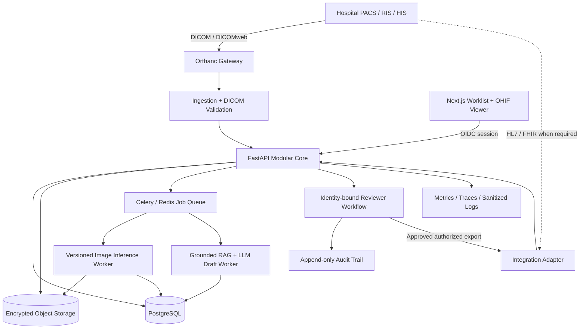

# ADR-004 — ScanFlow AI Modular Hospital Platform Architecture

- **Status:** Proposed — requires Tech Lead, Clinical Lead, Security Lead and Hospital IT approval
- **Date:** 2026-10-28
- **Decision owner:** Principal Engineer / Platform Lead
- **Scope:** Research-only hospital integration MVP, with gated path to regulated clinical product
- **Related:** PR #4 (audit), PR #5 (master blueprint), PR #6 (AI engineering operating system)

## 1. Decision

Build an **API-first modular monolith** for business workflows, separate **GPU image inference workers** and **RAG/LLM drafting workers**, and an **Orthanc DICOM gateway**. Use **Next.js + OHIF** for the user interface, **FastAPI** for API and domain modules, **PostgreSQL** for transactional metadata and audit, **Redis/Celery** for durable job orchestration (with retry/idempotency and recovery), and **encrypted S3-compatible object storage** for imaging artifacts. Maintain the existing Streamlit app as a separate research sandbox while incrementally migrating.

Do not build many microservices or Kubernetes infrastructure at the outset. Split modules into services only after evidence from scaling, isolation, availability or team ownership requires it.

## 2. Safety boundary

This architecture does **not** establish clinical validity or regulatory approval. Initial use: authorized de-identified adult frontal chest radiograph research. No autonomous diagnosis, urgent triage, patient-facing recommendations or automatic report signoff. All model scores and LLM drafts are experimental. Every unsupported, failed, uncertain or out-of-distribution study must be explicitly distinguished from no positive model findings.

## 3. Context and constraints

- Existing project: Streamlit research dashboard, BiomedCLIP/OpenCLIP, threshold script, RAG, Ollama and demo-level reviewer UI. Source/runtime audit incomplete.
- Existing Ubuntu VPS runs other projects. No global Docker, firewall, Apache, Virtualmin, GPU-driver or network changes without isolated impact assessment and rollback.
- Current GPU identified as RTX 3060 LHR; **verify actual VRAM, concurrent workloads, driver and CUDA compatibility** before sizing.
- Medical data handling, auditability, reproducibility, interoperability, least privilege, and model-version traceability are primary requirements.
- Reported public private-key exposure is P0; security remediation is independent of this architecture decision.

## 4. Logical architecture



**Security note:** OHIF should fetch authorized DICOMweb data through controlled gateway/proxy, not expose unrestricted Orthanc endpoints. Diagram arrows are logical flows, not permission grants.

## 5. Bounded contexts and ownership

| Context | Owns | Forbidden coupling |
|---|---|---|
| Identity/Facility | users, roles, facility scope, OIDC | UI-only authorization |
| Imaging | DICOM ingest, study metadata, validation, de-identification | silently changing clinical pixels |
| Worklist/Jobs | study/job lifecycle, idempotency, retry | direct synchronous GPU calls from UI |
| Inference | model registry, preprocessing, scores, thresholds, abstention | report signing |
| Knowledge/Drafting | corpus provenance, retrieval, schema-valid draft | inventing image evidence |
| Reporting/Review | report versions, reviewer signature, state transitions | auto-sign by LLM |
| Integration | DICOMweb, HL7/FHIR mappings, authorized exports | bypassing audit and access policy |
| Platform | telemetry, security, backup, retention | PHI in logs |

Keep a single FastAPI deployable initially but separate packages by context with explicit interfaces and migrations. Worker images can share versioned Python packages without direct database table coupling; prefer typed commands/events.

## 6. Proposed repository layout (future target; do not create empty scaffolding without task approval)

```text
/
├── AGENTS.md
├── apps/
│   ├── web/                 # Next.js worklist + OHIF integration
│   ├── api/                 # FastAPI modular monolith
│   └── research-streamlit/  # migrated demo only after verified parity
├── services/
│   ├── imaging-worker/      # DICOM validation / preprocessing
│   ├── inference-worker/    # PyTorch/MONAI classifier
│   └── drafting-worker/     # curated RAG, schema-constrained LLM
├── packages/
│   ├── contracts/           # OpenAPI/JSON schemas, enums, IDs
│   ├── imaging/             # validated pixel transforms
│   └── ml-common/           # model metadata / score contracts
├── infrastructure/
│   ├── compose/             # isolated dev and research pilot
│   ├── deployment/          # environment templates, no secrets
│   └── observability/
├── tests/
│   ├── unit/
│   ├── integration/
│   ├── dicom-fixtures/
│   ├── model-evaluation/
│   └── security/
└── docs/
    ├── architecture/adr/
    ├── ai-engineering/
    ├── clinical/
    ├── security/
    └── operations/
```

Do not move `integrated_app.py` until smoke tests, path compatibility and rollback are documented.

## 7. API and event contracts

**API:** `/api/v1/studies`, `/api/v1/jobs`, `/api/v1/inference-runs`, `/api/v1/reports`, `/api/v1/reviews`, `/api/v1/audit-events`, `/api/v1/integrations`, `/api/v1/health`. All enforce facility-scoped authorization, idempotency where relevant and typed error responses.

**Study states:** received -> validated -> queued -> processing -> draft_ready -> in_review -> signed, with separate unsupported, failed, rejected and cancelled branches. Transitions must be validated server-side and logged.

**Inference result:** study ID, model/version/weight hash, preprocessing version, label schema, score definition, threshold-set ID, raw scores, any calibrated values (with calibration provenance), uncertainty/abstention reason, timestamp and runtime metadata.

**Draft:** immutable linkage to input findings, model version, reference corpus snapshot and retrieval IDs; schema-validated; never signed.

**Signed report:** reviewer user ID, facility, report version, signing timestamp, immutable audit event, authorized export destination.

**Event examples:** StudyReceived, StudyValidated, InferenceRequested, InferenceCompleted, InferenceFailed, DraftGenerated, ReviewStarted, ReportSigned, ExportRequested, ExportCompleted. Use durable transactional outbox for reliable publication when event-driven boundaries are introduced; do not claim Redis alone guarantees exactly-once processing.

## 8. Model serving

- Research baseline: BiomedCLIP/OpenCLIP, supervised TorchXRayVision DenseNet121; compare task-specific MONAI models and licensed foundation embeddings on independent external data.
- Classification and report generation are **different services with separate validation gates**.
- Ollama is a serving runtime, not an accuracy score. Compare Transformers/vLLM (compatible text or multimodal models), Triton/ONNX Runtime for image inference, and Ollama/llama.cpp where supported.
- Evaluate MedGemma candidates for grounded drafting, not as automatically superior or approved diagnostic engines.
- GPU workers must support backpressure, job limits, timeouts, OOM recovery, model warmup and version pinning.
- Benchmark p50/p95/p99 latency, GPU VRAM, concurrent jobs, throughput, draft factuality and cost per study before choosing serving stack.

## 9. Data, PHI and deployment

- Separate study metadata from DICOM/image objects. Use encrypted object storage with access policies, checksums, retention and restore testing.
- Never log patient identifiers or image contents. Minimize PHI in prompts and telemetry. Research de-identification requires metadata and burned-in annotation review.
- Per-user OIDC/MFA, least-privilege roles, facility scoping, API authorization and auditable signing.
- Deploy on dedicated isolated Docker networks, scoped volumes, non-root services, resource quotas and explicit firewall/proxy routing. Do not reuse another project's credentials or database.
- Stage: local synthetic development -> isolated research staging -> authorized de-identified pilot -> regulated clinical deployment (only after approvals).
- Observability: Prometheus/Grafana, OpenTelemetry, sanitized logs, alerts for ingestion failures, queue lag, GPU OOM, report export failures and audit anomalies.

## 10. Delivery sequence and exit gates

### Phase A — Baseline and safety
1. Investigate reported `medical.pem` exposure, rotate affected secrets.
2. Inventory current entrypoints/dependencies, pin runtime, add smoke tests.
3. Remove unsupported clinical claims and approval UI semantics.
**Gate:** research demo still works; incident response documented; tests pass.

### Phase B — Correct inference core
1. Reproduce OpenCLIP output semantics; correct multi-label scoring.
2. Implement DICOM golden fixtures and validation.
3. Establish patient-level evaluation and model/threshold versioning.
**Gate:** reproducible research metrics; no clinical accuracy claim.

### Phase C — Platform vertical slice
1. FastAPI study upload and status; PostgreSQL migrations; encrypted storage.
2. Celery job -> versioned inference -> stored findings.
3. Authenticated review workflow and report versioning.
4. Next.js worklist; OHIF/Orthanc integration.
**Gate:** one de-identified study completes end-to-end with traceable errors, audit and rollback.

### Phase D — Operational pilot
1. CI/CD, secret/SBOM/container scans, backup/restore, dashboards, runbooks.
2. Hospital integration testing, security review, clinical research protocol.
3. Controlled shadow-mode pilot with authorized datasets.
**Gate:** external validation and operational evidence; human/clinical/regulatory signoff.

## 11. Decision alternatives

| Option | Decision | Reason |
|---|---|---|
| Continue Streamlit-only | Reject for hospital workflow | Limited enterprise workflow, review integrity and integration architecture |
| Rewrite immediately as many microservices | Reject now | Cost, coordination, operational complexity, migration risk |
| Modular monolith + independent workers | **Choose** | Clear boundaries, lower migration risk, scalable GPU isolation |
| Kubernetes from day one | Defer | Not justified before measured HA/scale needs |
| One multimodal LLM for everything | Reject | Classification evidence and generation safety must be evaluated independently |

## 12. Risks and mitigations

- **Clinical false negatives:** external validation, abstention, human review, research-only gate.
- **LLM hallucinations:** structured findings, constrained schema, citation provenance, deterministic fallback.
- **DICOM errors:** pixel golden tests, unsupported SOP rejection, reference viewer comparison.
- **Wrong-patient/report linkage:** immutable IDs, server-side authorization and state machine.
- **Security exposure:** secret incident response, isolated infrastructure, scanning, RBAC, audit.
- **Architecture drift from AI agents:** AGENTS.md, ADRs, bounded tasks, checkpoints, PR review.
- **GPU contention on shared VPS:** measure workloads; isolate and limit workers; avoid host-wide changes.
- **Unlicensed model/data:** legal/license review before commercial use.

## 13. Architecture acceptance criteria

- [ ] Tech/AI/Clinical/Security leads approve this ADR.
- [ ] API, data and model contracts are reviewed before implementation.
- [ ] No clinical or deployment claims without evidence.
- [ ] Existing research app remains functional during migration.
- [ ] Each vertical slice has tests, rollback and operational runbook.
- [ ] No production PHI or secrets in developer AI tools.
- [ ] Architecture changes use new ADRs; do not silently edit this decision.

**Next implementation task:** SEC-001 or BASE-001 from the task ledger, not wholesale repository restructuring.
